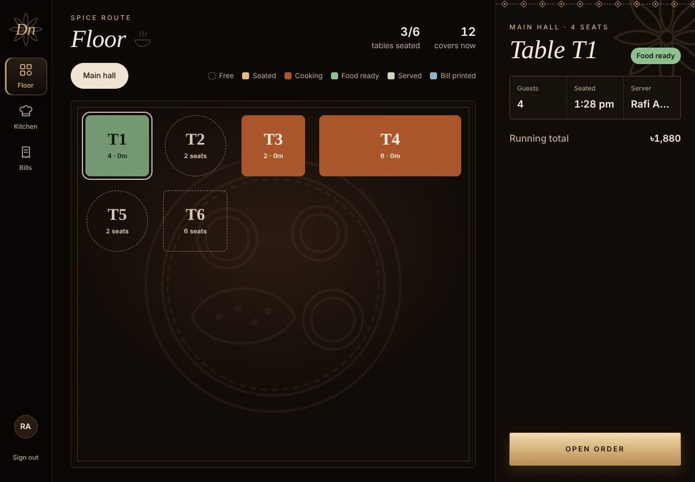
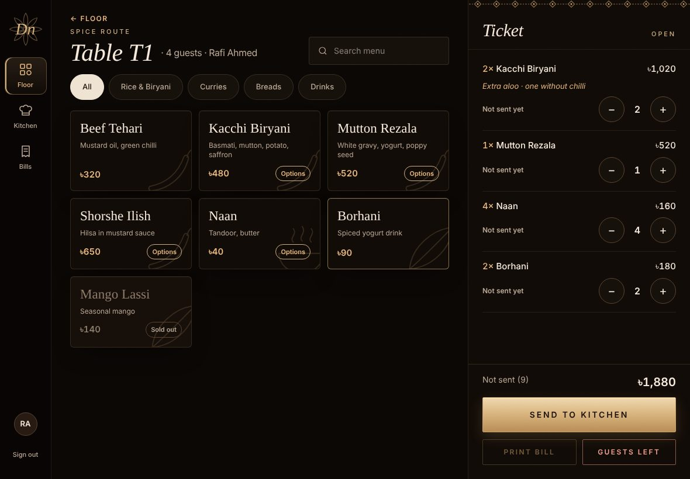
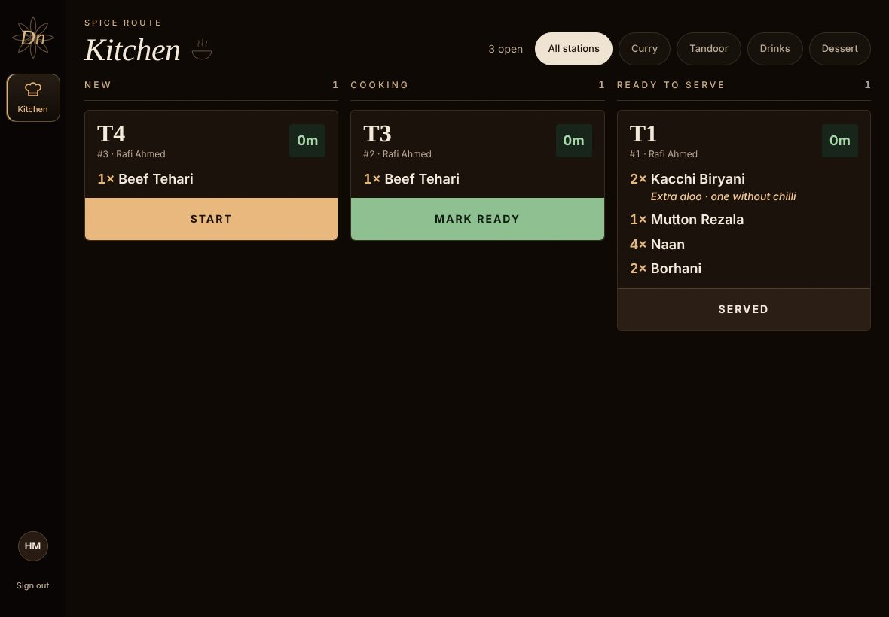
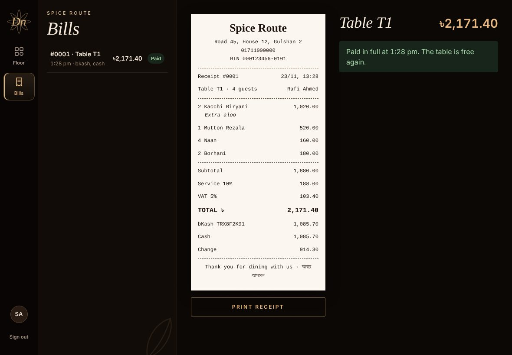

<div align="center">

# DineNiro

**Restaurant operations, from the floor to the bill.**

A multi-restaurant platform: each restaurant gets its own workspace and team, and a platform admin approves every restaurant before it goes live.


</div>

## What works today

**Running a service**

- **Floor.** Tables by section, coloured by what is happening at each one: free, seated, cooking, food ready, served, bill printed. Hosts and waiters seat guests with one tap.
- **Orders.** Waiters order from the menu by category or search, with priced options ("Extra aloo +৳30") and notes for the kitchen. Sold-out dishes can't be ordered. Nothing reaches the kitchen until they press Send.
- **Kitchen display.** Tickets move New → Cooking → Ready → Served, filtered by station, with timers that turn amber at 10 minutes and red when late. The floor sees food-ready tables at once.
- **Bills and payment.** Discount (managers only), then service charge, then VAT, at the restaurant's own rates. Split by number of guests and pay by cash (with change), card, bKash or Nagad. The receipt prints on 80 mm thermal paper with the restaurant's BIN. Paying in full frees the table.
- **Reservations.** A day timeline of tables from 11:00 to midnight. Tap an empty spot to book it, or let DineNiro suggest tables that fit the party and are free for the whole time. The database itself refuses overlapping bookings, even two made at the same moment. Tables booked within the hour show as Reserved on the floor.
- **Waitlist.** Walk-ins with a quoted wait. DineNiro flags anyone waiting longer than quoted, and won't seat a walk-in at a table booked within the hour.
- **Stock.** Ingredients with par levels and suppliers, and a recipe for each dish. Sending a dish to the kitchen takes its recipe off stock. Voiding it before cooking starts puts the stock back. Chefs record deliveries, counts and waste, and every change is in a ledger showing the dish and table behind each sale. Owners see the food cost of every plate. Waiters see "3 left" when stock runs low. Low stock warns, it doesn't block, because counts drift in a real kitchen.
- **Setup.** Owners and managers add tables, menu categories and dishes, mark dishes sold out, and set billing rates.

| Floor | Order |
|---|---|
|  |  |
| **Kitchen display** | **Bill and receipt** |
|  |  |

**The platform**

- **Restaurant applications.** An owner applies with the restaurant's details, trade licence and VAT BIN, and can sign in straight away to see where the application stands.
- **Platform approvals.** A platform admin approves, rejects or suspends with a reason, reinstates or reopens, and has a full audit trail of who changed what.
- **Teams and roles.** Owners and managers add staff as manager, cashier, host, waiter or chef. Each role sees only the screens it uses: chefs open straight into the kitchen, cashiers into bills.
- **Isolation between restaurants.** Every restaurant request is checked against the signed-in person's own membership, and the database itself stops an order from pointing at another restaurant's table or dish.

### Who can do what

| | Owner | Manager | Waiter | Host | Cashier | Chef |
|---|:-:|:-:|:-:|:-:|:-:|:-:|
| Seat a table | ✓ | ✓ | ✓ | ✓ | | |
| Bookings and waitlist | ✓ | ✓ | ✓ | ✓ | view | |
| Order and send to the kitchen | ✓ | ✓ | ✓ | | | |
| Void a sent dish, give a discount | ✓ | ✓ | | | | |
| Kitchen display: start and finish tickets | ✓ | ✓ | | | | ✓ |
| Mark ready food as served | ✓ | ✓ | ✓ | | | ✓ |
| Print the bill | ✓ | ✓ | ✓ | | ✓ | |
| Take payment | ✓ | ✓ | | | ✓ | |
| Deliveries, counts, waste | ✓ | ✓ | | | | ✓ |
| Ingredients and recipes | ✓ | ✓ | | | | view |
| Tables, menu, billing rates, team | ✓ | ✓ | | | | |

Managers manage cashiers, hosts, waiters and chefs. Only owners manage owners and managers.

### Coming next

| Stage | What it adds |
|---|---|
| Reports | Daily sales, top dishes, staff totals, payment mix |
| Printing | Automatic receipt and kitchen-ticket printing through a small helper on the counter PC (browsers can't print silently) |

## Get started

You need Node.js 20 or later and PostgreSQL 15 or later (with the standard `btree_gist` extension, which Supabase and Neon both provide).

```bash
npm ci
cp .env.example .env
```

Fill in `.env`:

| Variable | What it is |
|---|---|
| `DATABASE_URL` | PostgreSQL connection string. Set `DATABASE_SSL=false` for a local database without TLS. Supabase variables work too. |
| `JWT_SECRET` | At least 32 random characters. The server refuses to start without it. |
| `DINENIRO_ADMIN_PASSWORD` | Password for the first platform admin (12+ characters). If it's missing, no admin is created. |
| `DINENIRO_ADMIN_EMAIL` | Optional email for that admin. Defaults to `admin@dineniro.local`. |

```bash
npm run dev      # http://localhost:3000
```

The schema is applied on start-up. Sign in as `admin` with your admin password, then apply for a restaurant from a private window and approve it. As the owner, open **Setup** to add tables and dishes, and **Team** to add staff.

## Tests

```bash
npm run lint     # TypeScript
npm test         # unit tests; API tests too when TEST_DATABASE_URL is set
TEST_DATABASE_URL=postgresql://postgres@localhost:5432/dineniro_test npm test
```

The API tests start the real server against that database and **wipe it first**, so point them at a database you don't need. They cover applying, the approval rules and audit trail, owner and manager limits, the last-owner rule, isolation between restaurants, session revocation, and a whole dinner service: setup, seating, ordering with options, the kitchen ticket's steps, voids, discounts, VAT and service charge, split payment and the receipt.

## API

| Method | Path | Who |
|---|---|---|
| `POST` | `/api/auth/login` | anyone |
| `GET` | `/api/auth/me` | anyone (guests get `authenticated: false`) |
| `POST` | `/api/auth/logout` | signed in |
| `POST` | `/api/restaurants` | anyone: apply with a new owner account |
| `GET` | `/api/restaurants/:restaurantId` | members of that restaurant |
| `GET` `POST` | `/api/restaurants/:restaurantId/staff` | owners and managers, approved restaurants |
| `PATCH` `DELETE` | `/api/restaurants/:restaurantId/staff/:userId` | owners and managers, approved restaurants |
| `GET` | `/api/admin/stats` | platform admins |
| `GET` | `/api/admin/restaurants?status=` | platform admins |
| `PUT` | `/api/admin/restaurants/:id/status` | platform admins |
| `GET` | `/api/admin/restaurants/audit` | platform admins |
| `POST` | `/api/admin/admins` | platform admins |

Service routes, all under `/api/restaurants/:restaurantId` for approved restaurants (roles as in the table above):

| Method | Path | What it does |
|---|---|---|
| `PATCH` | `/settings` | service charge %, VAT %, receipt footer |
| `GET` `POST` / `PUT` | `/tables`, `/tables/:tableId` | tables |
| `GET` | `/menu` | categories with dishes and options |
| `POST` `PUT` `DELETE` | `/categories`, `/categories/:id` | menu categories |
| `POST` `PUT` | `/menu-items`, `/menu-items/:id` | dishes and their options |
| `GET` | `/floor` | every table with its current state |
| `POST` | `/orders` | seat a table |
| `GET` | `/orders/:orderId` | an order with its lines |
| `POST` `PATCH` | `/orders/:orderId/items`, `/items/:itemId` | add a dish, change or remove an unsent one |
| `POST` | `/orders/:orderId/items/:itemId/void` | void a sent dish with a reason |
| `POST` | `/orders/:orderId/send` | send unsent dishes to the kitchen |
| `POST` | `/orders/:orderId/void` | cancel a visit where nothing was sent |
| `GET` | `/kitchen` | open tickets |
| `POST` | `/kitchen/:ticketId/advance` | move a ticket one step, naming its current status |
| `POST` | `/orders/:orderId/bill` | print (or reprint with a discount) the bill |
| `GET` | `/bills`, `/bills/:billId` | recent bills; one bill with everything for its receipt |
| `POST` | `/bills/:billId/payments` | take a payment |
| `GET` `POST` / `PUT` | `/reservations?from=&to=`, `/reservations/:id` | bookings in a time range; book or change |
| `POST` | `/reservations/:id/close`, `/reservations/:id/seat` | cancel or no-show; seat the party |
| `GET` | `/availability?startsAt=&minutes=&party=` | tables free for that time that fit the party |
| `GET` `POST` | `/waitlist` | waiting walk-ins; add one |
| `POST` | `/waitlist/:id/seat`, `/waitlist/:id/left` | seat at a table; they left |
| `GET` `POST` / `PUT` | `/ingredients`, `/ingredients/:id` | stock list with usage; add or change an ingredient |
| `POST` | `/ingredients/:id/stock` | record a delivery, count or waste |
| `GET` | `/ingredients/:id/history` | the ledger for one ingredient |
| `GET` `PUT` | `/recipes/:menuItemId` | a dish's recipe |

## Architecture

- `schema.sql`: tables, integrity triggers, and every query the API runs, as `dineniro_*` functions. See [database design](./docs/database-design.md).
- `server/`: Express API. `app.ts` builds it, `index.ts` adds Vite in development or the built files in production.
- `src/`: React app, Tailwind 4 theme in `src/index.css`.

Sessions are httpOnly cookies holding a 12-hour JWT whose ID is stored in the database, so signing out takes effect immediately. Passwords are hashed with bcrypt.
