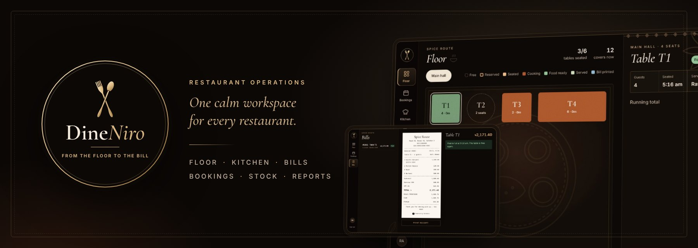
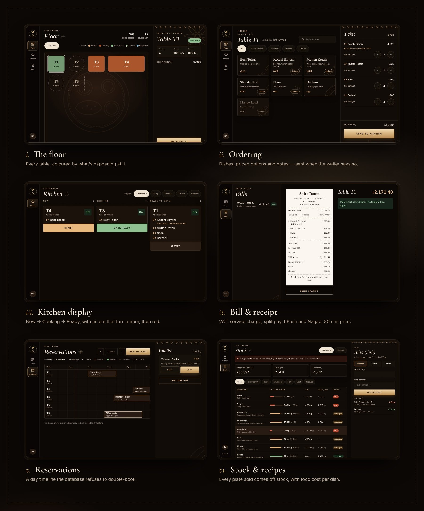
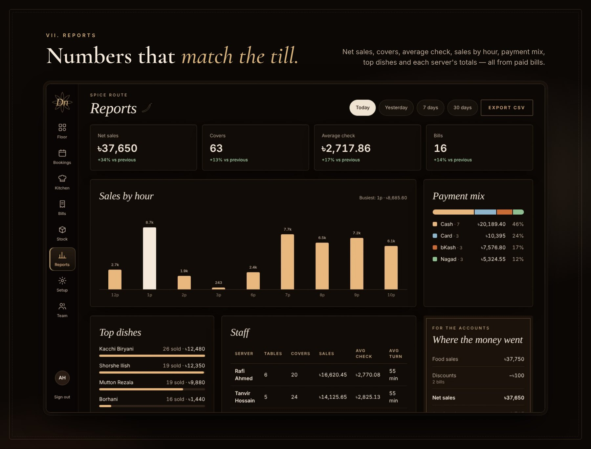

<p align="center">
  
</p>

<p align="center">
  <a href="https://dineniro-xhdy.onrender.com"><b>Live demo</b></a>
  &nbsp;&nbsp;·&nbsp;&nbsp;
  <a href="#the-service">The service</a>
  &nbsp;&nbsp;·&nbsp;&nbsp;
  <a href="#get-started">Get started</a>
  &nbsp;&nbsp;·&nbsp;&nbsp;
  <a href="./docs/database-design.md">Database design</a>
</p>

<p align="center">
  
  
  
  
  
  
</p>

<br />

> **DineNiro runs a restaurant's whole service in one place.** Every restaurant gets its own workspace and team; a platform admin approves each one before it goes live. Waiters, chefs, cashiers and hosts each see only the screens they use — and the rules that matter most (no double-booked tables, no cross-restaurant data, stock that always adds up) are enforced by the database itself, not just the interface.

<br />

## The service

<p align="center">
  
</p>

<table>
<tr>
<td width="50%" valign="top">

### 🍽️ Floor
Tables by section, coloured by what's happening: free, seated, cooking, food ready, served, bill printed. One tap seats a party.

### 📝 Orders
Order by category or search, with priced options (“Extra aloo +৳30”) and kitchen notes. Sold-out dishes can't be ordered, and nothing reaches the kitchen until the waiter presses **Send**.

### 🔥 Kitchen display
Tickets move **New → Cooking → Ready → Served**, filtered by station. Timers turn amber at 10 minutes and red when late; the floor sees ready food instantly.

### 🧾 Bills & payment
Discount (managers only), then service charge, then VAT at the restaurant's own rates. Split by guests; pay by cash with change, card, **bKash** or **Nagad**. Receipts print on 80 mm thermal paper with the restaurant's name and BIN at the top, and a small DineNiro mark at the foot.

</td>
<td width="50%" valign="top">

### 📅 Reservations
A day timeline from 11:00 to midnight. Tap a gap to book, or let DineNiro suggest tables that fit the party for the whole slot. The database refuses overlapping bookings — even two made at the same instant.

### ⏳ Waitlist
Walk-ins with a quoted wait. Anyone past their quote is flagged, and walk-ins are never seated at a table booked within the hour.

### 📦 Stock & recipes
Sending a dish deducts its recipe; voiding before cooking returns it. Deliveries, counts and waste go into a ledger that names the dish and table behind every sale. Owners see food cost per plate; waiters see “3 left”.

### ⚙️ Setup
Owners and managers manage tables, categories, dishes, sold-out flags and billing rates.

</td>
</tr>
</table>

<br />

<p align="center">
  
</p>

**Reports** compare today, yesterday, 7 or 30 days against the period before: net sales, covers, average check, sales by hour or day, payment mix, top dishes, each server's totals and table times, and a money breakdown for the accounts — discounts, service charge, VAT collected, voids and food cost %. Everything comes from paid bills, so it matches the till, and it all exports to CSV.

<br />

## The platform

<table>
<tr>
<td width="33%" valign="top">

**Applications**<br />
An owner applies with the trade licence and VAT BIN, and can sign in at once to follow the review.

</td>
<td width="33%" valign="top">

**Approvals**<br />
Platform admins approve, reject, suspend, reinstate or reopen — always with a reason, always in the audit trail.

</td>
<td width="33%" valign="top">

**Isolation**<br />
Every request is checked against the user's membership, and composite keys stop an order from touching another restaurant's tables or dishes.

</td>
</tr>
</table>

**On the tablet.** Open DineNiro in the browser and choose *Add to Home Screen*. It installs with its own brass icon and opens full screen, like an app, so the floor tablet and the kitchen screen never show a browser bar.

<details>
<summary><b>Who can do what</b></summary>
<br />

| | Owner | Manager | Waiter | Host | Cashier | Chef |
|---|:-:|:-:|:-:|:-:|:-:|:-:|
| Seat a table | ✓ | ✓ | ✓ | ✓ | | |
| Bookings and waitlist | ✓ | ✓ | ✓ | ✓ | view | |
| Order and send to the kitchen | ✓ | ✓ | ✓ | | | |
| Void a sent dish, give a discount | ✓ | ✓ | | | | |
| Kitchen display: start and finish tickets | ✓ | ✓ | | | | ✓ |
| Mark ready food as served | ✓ | ✓ | ✓ | | | ✓ |
| Print the bill | ✓ | ✓ | ✓ | | ✓ | |
| Take payment | ✓ | ✓ | | | ✓ | |
| Deliveries, counts, waste | ✓ | ✓ | | | | ✓ |
| Ingredients and recipes | ✓ | ✓ | | | | view |
| Reports | ✓ | ✓ | | | | |
| Tables, menu, billing rates, team | ✓ | ✓ | | | | |

Managers manage cashiers, hosts, waiters and chefs. Only owners manage owners and managers. Chefs open straight into the kitchen, cashiers into bills.

</details>

<br />

## Get started

You need **Node.js 20+** and **PostgreSQL 15+** with the standard `btree_gist` extension (Neon and Supabase both include it).

```bash
npm ci
cp .env.example .env   # then fill it in
npm run dev            # http://localhost:3000
```

| Variable | |
|---|---|
| `DATABASE_URL` | PostgreSQL connection string. Add `DATABASE_SSL=false` for a local database without TLS. |
| `JWT_SECRET` | 32+ random characters — the server won't start without it. |
| `DINENIRO_ADMIN_PASSWORD` | 12+ characters. Creates the first platform admin on first start. |
| `DINENIRO_ADMIN_EMAIL` | Optional. Defaults to `admin@dineniro.local`. |

The schema applies itself on start-up. Sign in as `admin`, apply for a restaurant from a private window, approve it, then open **Setup** and **Team** as the owner.

<details>
<summary><b>Deploy on Render + Neon</b></summary>
<br />

`render.yaml` describes the whole service (Singapore region).

1. Create an empty Neon project and copy its **direct** connection string — the host without `-pooler`.
2. In Render choose **New → Blueprint**, pick this repo, and paste the Neon string as `DATABASE_URL`.
3. Render generates `JWT_SECRET` and `DINENIRO_ADMIN_PASSWORD`. On first start the app builds the schema and the admin account; the password is under the service's **Environment** tab.

Every push to `main` redeploys. The free plan sleeps after 15 idle minutes and takes about a minute to wake — use Starter for a restaurant in real service.

</details>

<details>
<summary><b>Tests</b></summary>
<br />

```bash
npm run lint   # TypeScript
TEST_DATABASE_URL=postgresql://postgres@localhost:5432/dineniro_test npm test
```

The API tests run the real server against that database and **wipe it first**. They cover applications, approvals and the audit trail, role limits, the last-owner rule, isolation between restaurants, session revocation, a full dinner service, overlapping bookings, stock deduction and reports.

</details>

<details>
<summary><b>API reference</b></summary>
<br />

| Method | Path | Who |
|---|---|---|
| `POST` | `/api/auth/login` | anyone |
| `GET` | `/api/auth/me` | anyone (guests get `authenticated: false`) |
| `POST` | `/api/auth/logout` | signed in |
| `GET` | `/api/health` | anyone |
| `POST` | `/api/restaurants` | anyone: apply with a new owner account |
| `GET` | `/api/restaurants/:restaurantId` | members of that restaurant |
| `GET` `POST` | `/api/restaurants/:restaurantId/staff` | owners and managers |
| `PATCH` `DELETE` | `/api/restaurants/:restaurantId/staff/:userId` | owners and managers |
| `GET` | `/api/admin/stats` | platform admins |
| `GET` | `/api/admin/restaurants?status=` | platform admins |
| `PUT` | `/api/admin/restaurants/:id/status` | platform admins |
| `GET` | `/api/admin/restaurants/audit` | platform admins |
| `POST` | `/api/admin/admins` | platform admins |

Service routes, under `/api/restaurants/:restaurantId` for approved restaurants:

| Method | Path | What it does |
|---|---|---|
| `PATCH` | `/settings` | service charge %, VAT %, receipt footer |
| `GET` `POST` / `PUT` | `/tables`, `/tables/:tableId` | tables |
| `GET` | `/menu` | categories with dishes and options |
| `POST` `PUT` `DELETE` | `/categories`, `/categories/:id` | menu categories |
| `POST` `PUT` | `/menu-items`, `/menu-items/:id` | dishes and their options |
| `GET` | `/floor` | every table with its current state |
| `POST` | `/orders` | seat a table |
| `GET` | `/orders/:orderId` | an order with its lines |
| `POST` `PATCH` | `/orders/:orderId/items`, `/items/:itemId` | add a dish; change or remove an unsent one |
| `POST` | `/orders/:orderId/items/:itemId/void` | void a sent dish with a reason |
| `POST` | `/orders/:orderId/send` | send unsent dishes to the kitchen |
| `POST` | `/orders/:orderId/void` | cancel a visit where nothing was sent |
| `GET` | `/kitchen` | open tickets |
| `POST` | `/kitchen/:ticketId/advance` | move a ticket one step |
| `POST` | `/orders/:orderId/bill` | print (or reprint with a discount) the bill |
| `GET` | `/bills`, `/bills/:billId` | recent bills; one bill with its receipt |
| `POST` | `/bills/:billId/payments` | take a payment |
| `GET` `POST` / `PUT` | `/reservations?from=&to=`, `/reservations/:id` | bookings in a range; book or change |
| `POST` | `/reservations/:id/close`, `/reservations/:id/seat` | cancel or no-show; seat the party |
| `GET` | `/availability?startsAt=&minutes=&party=` | free tables that fit the party |
| `GET` `POST` | `/waitlist` | waiting walk-ins; add one |
| `POST` | `/waitlist/:id/seat`, `/waitlist/:id/left` | seat at a table; they left |
| `GET` `POST` / `PUT` | `/ingredients`, `/ingredients/:id` | stock list; add or change an ingredient |
| `POST` | `/ingredients/:id/stock` | record a delivery, count or waste |
| `GET` | `/ingredients/:id/history` | one ingredient's ledger |
| `GET` `PUT` | `/recipes/:menuItemId` | a dish's recipe |
| `GET` | `/reports?from=&to=&tz=` | sales report with the previous period |

</details>

<br />

## Under the hood

- **`schema.sql`**: every table, integrity trigger and query the API runs, as `dineniro_*` PostgreSQL functions. Read the [database design](./docs/database-design.md).
- **`server/`**: Express API. `app.ts` builds it; `index.ts` adds Vite in development or serves the build in production.
- **`src/`**: React 19 app, with the Tailwind 4 theme in `src/index.css`.

Sessions are httpOnly cookies holding a 12-hour JWT whose ID lives in the database, so signing out takes effect immediately. Passwords are hashed with bcrypt.

**Coming next:** silent receipt and kitchen-ticket printing through a small helper on the counter PC, since browsers can't print without a dialog.

<br />

<p align="center">
  <sub>DineNiro · built for restaurants in Bangladesh · ৳</sub>
</p>
