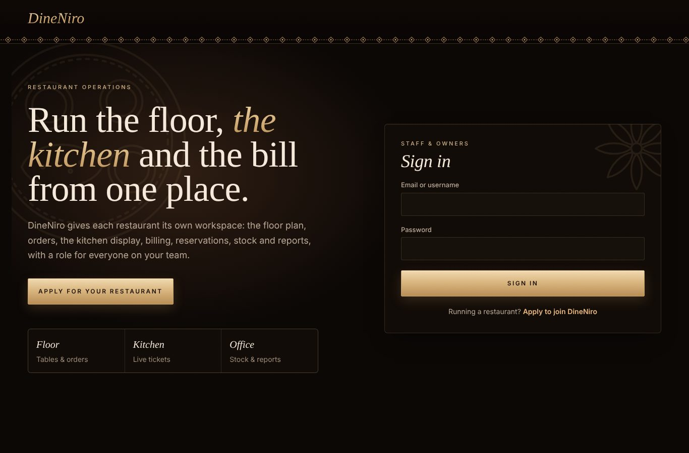
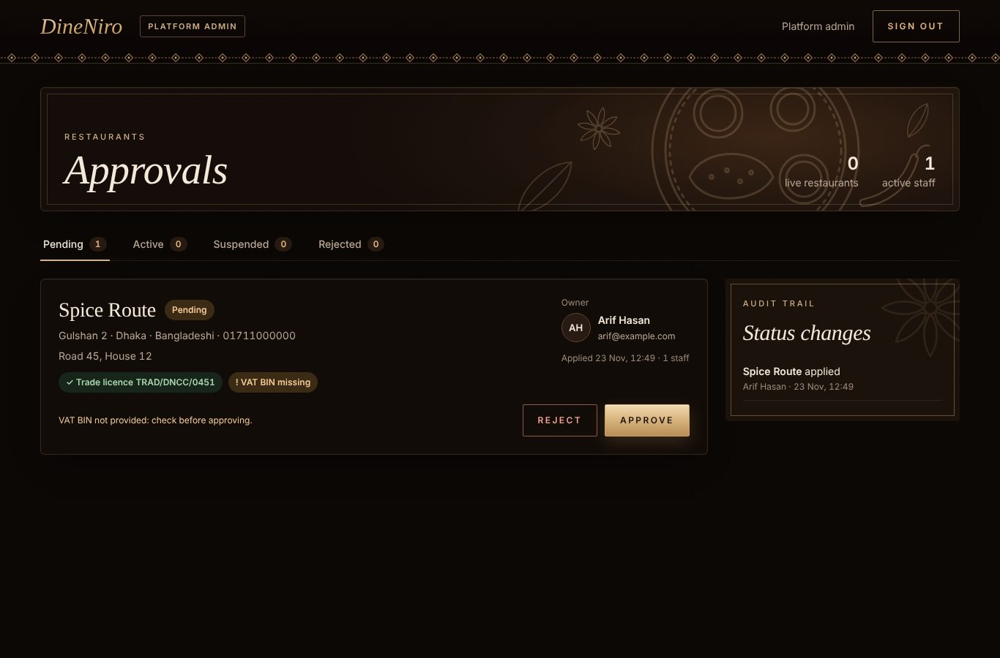
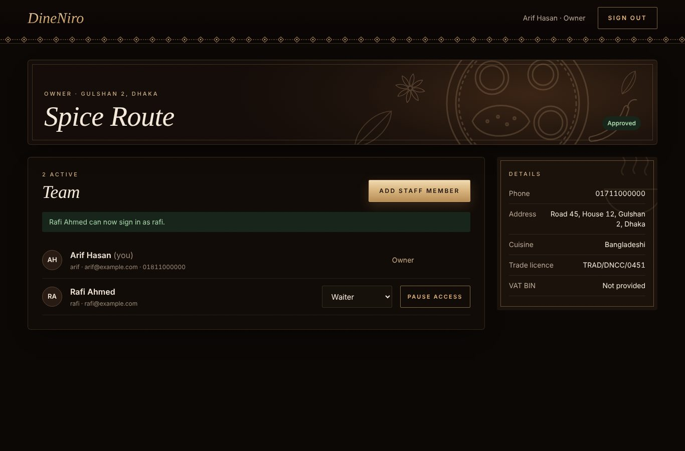

<div align="center">

# DineNiro

**Restaurant operations, from the floor to the bill.**

A multi-restaurant platform: each restaurant gets its own workspace and team, and a platform admin approves every restaurant before it goes live.




</div>

## What works today

DineNiro is being built in stages. This first stage is the foundation everything else sits on:

- **Restaurant applications.** An owner applies with the restaurant's details, trade licence and VAT BIN, and can sign in straight away to see where the application stands.
- **Platform approvals.** A platform admin sees applications by status, approves, rejects or suspends with a reason, reinstates or reopens, and has a full audit trail of who changed what.
- **Teams and roles.** Once approved, owners and managers add staff as manager, cashier, host, waiter or chef, change roles, and pause or remove access. Only owners can manage owners and managers, and a restaurant always keeps at least one owner.
- **Isolation between restaurants.** Every restaurant request is checked against the signed-in person's own membership. Another restaurant's data simply isn't found.

| Platform admin | Owner's team |
|---|---|
|  |  |

### Coming next

| Stage | What it adds |
|---|---|
| Service | Floor plan and tables, menu with modifiers, table orders, kitchen display, bills with split payment (cash, card, bKash, Nagad) and printed receipts |
| Reservations | Bookings by time slot, a walk-in waitlist, no double-booked tables |
| Inventory | Ingredients, recipes that deduct stock as tickets are fired, low-stock alerts |
| Reports | Daily sales, top dishes, staff totals, payment mix |

## Get started

You need Node.js 20 or later and a PostgreSQL database.

```bash
npm ci
cp .env.example .env
```

Fill in `.env`:

| Variable | What it is |
|---|---|
| `DATABASE_URL` | PostgreSQL connection string. Set `DATABASE_SSL=false` for a local database without TLS. Supabase variables work too. |
| `JWT_SECRET` | At least 32 random characters. The server refuses to start without it. |
| `DINENIRO_ADMIN_PASSWORD` | Password for the first platform admin (12+ characters). If it's missing, no admin is created. |
| `DINENIRO_ADMIN_EMAIL` | Optional email for that admin. Defaults to `admin@dineniro.local`. |

```bash
npm run dev      # http://localhost:3000
```

The schema is applied on start-up. Sign in as `admin` with your admin password, then apply for a restaurant from a private window and approve it.

## Tests

```bash
npm run lint     # TypeScript
npm test         # unit tests; API tests too when TEST_DATABASE_URL is set
TEST_DATABASE_URL=postgresql://postgres@localhost:5432/dineniro_test npm test
```

The API tests start the real server against that database and **wipe it first**, so point them at a database you don't need. They cover applying, the approval rules and audit trail, owner and manager limits, the last-owner rule, isolation between restaurants, and session revocation.

## API

| Method | Path | Who |
|---|---|---|
| `POST` | `/api/auth/login` | anyone |
| `GET` | `/api/auth/me` | anyone (guests get `authenticated: false`) |
| `POST` | `/api/auth/logout` | signed in |
| `POST` | `/api/restaurants` | anyone: apply with a new owner account |
| `GET` | `/api/restaurants/:restaurantId` | members of that restaurant |
| `GET` `POST` | `/api/restaurants/:restaurantId/staff` | owners and managers, approved restaurants |
| `PATCH` `DELETE` | `/api/restaurants/:restaurantId/staff/:userId` | owners and managers, approved restaurants |
| `GET` | `/api/admin/stats` | platform admins |
| `GET` | `/api/admin/restaurants?status=` | platform admins |
| `PUT` | `/api/admin/restaurants/:id/status` | platform admins |
| `GET` | `/api/admin/restaurants/audit` | platform admins |
| `POST` | `/api/admin/admins` | platform admins |

## Architecture

- `schema.sql`: tables, integrity triggers, and every query the API runs, as `dineniro_*` functions. See [database design](./docs/database-design.md).
- `server/`: Express API. `app.ts` builds it, `index.ts` adds Vite in development or the built files in production.
- `src/`: React app, Tailwind 4 theme in `src/index.css`.

Sessions are httpOnly cookies holding a 12-hour JWT whose ID is stored in the database, so signing out takes effect immediately. Passwords are hashed with bcrypt.
