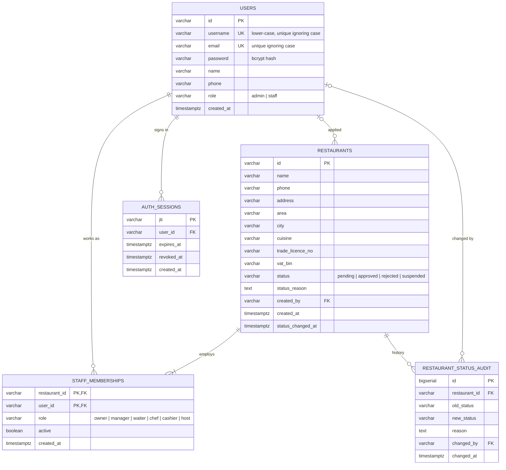
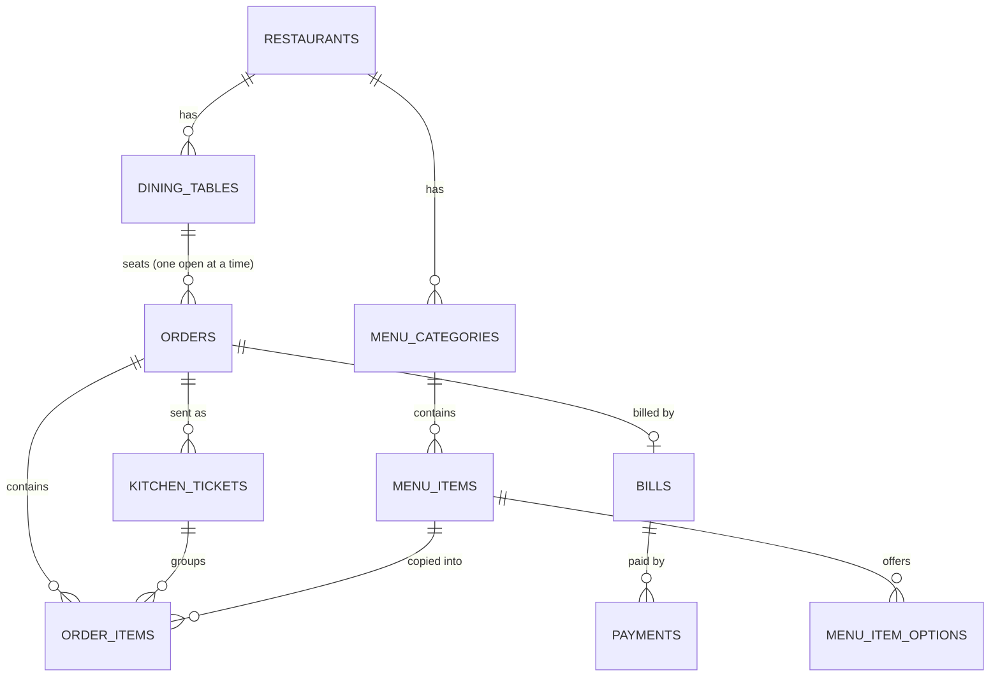
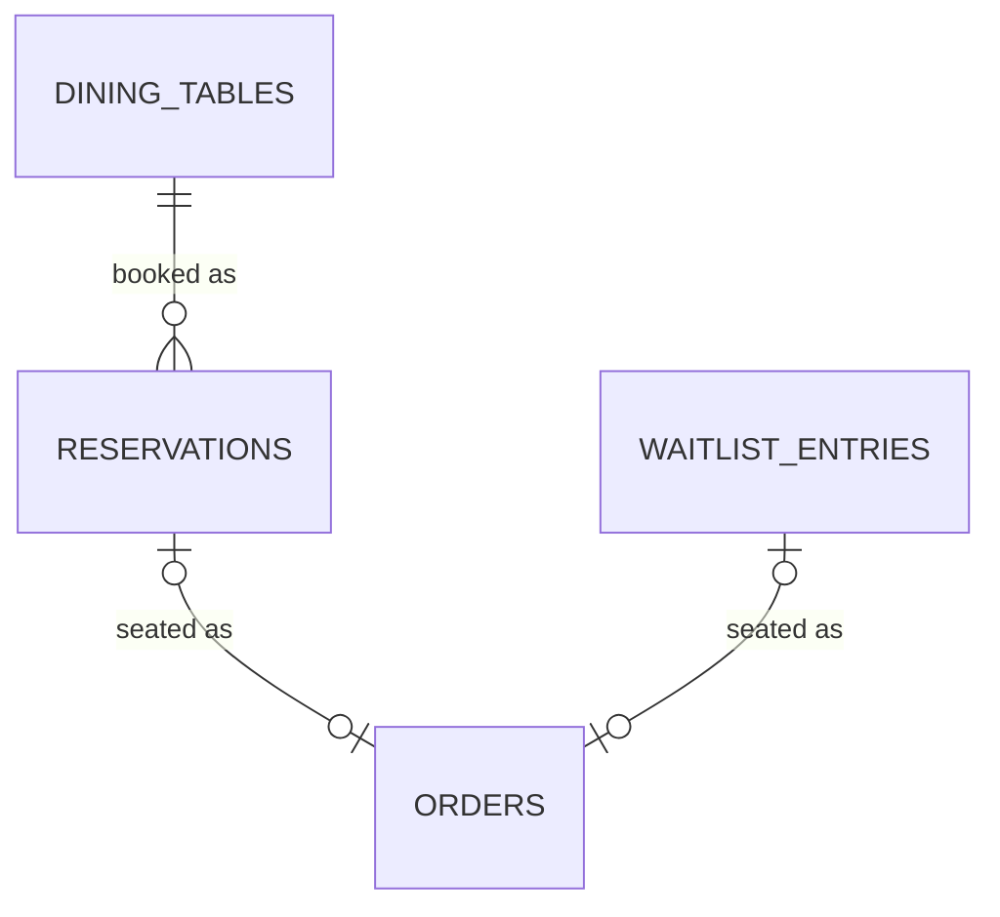
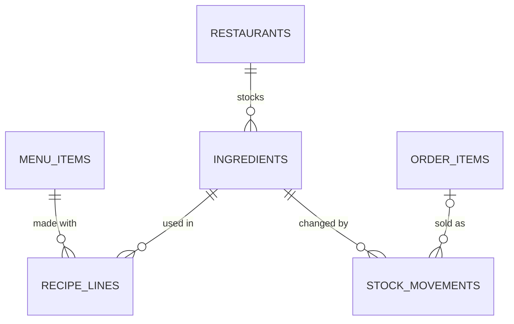

# DineNiro database design

DineNiro runs on PostgreSQL. `schema.sql` is applied on every server start, so every statement in it is idempotent. The API never writes SQL inline against tables: every read and write goes through a `dineniro_*` function in the schema.

## Entity-relationship diagram



## Accounts

There are two kinds of account. A **platform admin** (`users.role = 'admin'`) approves and suspends restaurants and never works inside one. A **staff** account (`role = 'staff'`) belongs to restaurants through `staff_memberships`, with one role per restaurant. The same person can be a manager at one restaurant and a waiter at another.

The first admin is created at start-up from `DINENIRO_ADMIN_PASSWORD`. Later admins are added by an existing admin. No demo data is seeded.

## Restaurant approval

A new owner applies through `dineniro_restaurant_apply`, which creates their account, the restaurant (status `pending`) and their `owner` membership in one transaction.

`dineniro_restaurant_status_update` allows only these moves:

| From | To |
|---|---|
| pending | approved, rejected |
| approved | suspended |
| suspended | approved |
| rejected | pending |

Rejecting or suspending needs a reason, which owners and staff see. The `trigger_restaurant_status_change` trigger writes every change, including the first `pending` row, to `restaurant_status_audit`. The acting user comes from the transaction setting `dineniro.actor_id`, which the status functions set.

Staff management requires an approved restaurant. That rule is enforced in the API (`requireMembership({ requireApproved: true })`).

## Staff rules held by the database

- `trigger_membership_user_role`: only staff accounts can join a restaurant.
- `trigger_protect_last_owner`: removing, demoting or pausing the last active owner is refused. The restaurant's owner rows are locked first, so two concurrent requests cannot both remove the last two owners.
- `dineniro_staff_add` links an existing staff account found by email instead of creating a duplicate. That account keeps its own password.

Owners can manage every role. Managers can add and change cashiers, hosts, waiters and chefs only. The API enforces this in `server/routes/staff.routes.ts`.

## Isolation between restaurants

Every restaurant-scoped route has `:restaurantId` in its path and goes through `requireMembership`. That middleware loads the caller's own active membership for that restaurant. If there is none, it answers 404, the same answer as for a restaurant that does not exist, so one restaurant cannot find out another's IDs. Service tables carry `restaurant_id` and are read only through this check (see Service below).

## Sessions

Each sign-in issues a 12-hour JWT whose `jti` is stored in `auth_sessions`. Every API request checks that the `jti` is still active, so signing out revokes the session immediately. Expired rows are cleaned up when the next session is created.

## Service



Restaurants also carry `service_charge_pct`, `vat_pct` (each 0 to 30) and `receipt_footer`.

**Keeping restaurants apart in the database.** Each service table has `restaurant_id`, and every parent has a `UNIQUE (restaurant_id, id)` key. Children reference that pair, for example `orders (restaurant_id, table_id) → dining_tables (restaurant_id, id)`. So an order cannot point at another restaurant's table, and an order line cannot point at another restaurant's dish, even if the API had a bug. Every `dineniro_*` service function also takes the restaurant ID first and filters by it.

**A visit.** `orders.status` moves `open → billed → paid`, or `open → void` when guests leave before anything was sent. A partial unique index (`uq_orders_active_table`) allows only one open or billed order per table.

**Order lines.** `order_items` copies the dish name and its price including chosen options, so editing the menu never changes a past order. Lines start as `draft`. Tapping the same dish with the same options and note adds to the draft line. Sending turns every draft line into `sent` and groups them into one kitchen ticket. A sent line can't be deleted: a manager voids it with a reason, and voided lines are not billed or printed.

**Kitchen tickets** move `new → cooking → ready → served`. `dineniro_ticket_advance` must be told the status the ticket is moving from, so a second tap from another screen cannot skip a step. Ticket numbers count up per restaurant, serialised by locking the restaurant row.

**Bills.** `dineniro_bill_prepare` refuses while dishes are unsent, then fixes the amounts:

```
food      = sum of sent lines
discount  ≤ food                      (managers and owners only)
service   = round((food − discount) × service %, 2)
VAT       = round((food − discount + service) × VAT %, 2)
total     = food − discount + service + VAT
```

Adding food after the bill is printed drops the bill and reopens the order, unless a payment has already been taken. Then the change is refused.

**Payments.** Cash, card, bKash or Nagad. `dineniro_payment_add` locks the bill and refuses anything above what is left. When payments cover the total, the bill and order close and the table shows as free. Cash stores the amount received (`tendered`) for the change line. bKash and Nagad require the transaction ID, enforced by the API.

## Reservations and the waitlist



**No double booking.** `reservations` has an exclusion constraint:

```sql
EXCLUDE USING gist (table_id WITH =, tstzrange(starts_at, ends_at) WITH &&)
WHERE (status IN ('booked', 'seated'))
```

Two live bookings for the same table can never overlap. Ranges are half-open, so a 6–7:30 pm booking and a 7:30–9 pm booking on the same table are both allowed. This needs the `btree_gist` extension, which the schema creates. Because the check is in the database, it holds even when two hosts press Book at the same moment. One succeeds and the other gets a plain-language 409.

**Booking life.** `booked → seated → completed`, or `booked → cancelled / no_show`. Cancelling or a no-show frees the time at once. Seating a booking opens an order at its table (`dineniro_reservation_seat`). When that order is paid or voided, the trigger `trigger_complete_reservation` marks the booking completed and trims its end time to now, so the rest of its slot can be booked again.

**Availability.** `dineniro_tables_available` lists active tables that seat the party (allowing two extra chairs) and have no live booking overlapping the requested time. Tables that fit without extra chairs come first, then the smallest.

**Waitlist.** `waitlist_entries` are `waiting`, `seated` or `left`. `dineniro_waitlist_seat` refuses a table with a booking starting within the next hour, so walk-ins don't take a booked party's table.

**On the floor.** `dineniro_floor` includes each table's next live booking in the next 12 hours. A free table whose booking starts within the hour, or whose guests are running late, has state `reserved`.

Requires PostgreSQL 15 or later: the foreign keys from bookings and waitlist entries to orders use `ON DELETE SET NULL (order_id)`.

## Inventory



**The ledger is the truth.** Every change to stock is a row in `stock_movements`: `sale`, `void`, `delivery`, `count` or `waste`, with the cost at the time and who recorded it. The trigger `trigger_apply_stock_movement` adds each change to `ingredients.on_hand`, so the on-hand figure always equals the sum of the ledger. On-hand may go negative. That means the kitchen used more than was recorded, and a count will correct it.

**Selling uses the recipe.** `recipe_lines` say how much of each ingredient one portion uses, in that ingredient's unit (kg, g, l, ml or pieces). When an order line changes from `draft` to `sent`, the trigger `trigger_move_stock_for_order_item` writes a `sale` movement per recipe line (portion × quantity). If the line is voided while its ticket is still `new`, the same amounts come back as `void` movements. After the kitchen has started, nothing comes back, because the food was made.

**Counts** record the difference between what was counted and what the system expected. **Deliveries** can also set a new cost per unit. **Waste** needs a reason (enforced by the API).

**Portions left and food cost.** `dineniro_menu` reports, for each dish with a recipe, how many more portions the recorded stock allows (the scarcest ingredient decides) and the ingredient cost of one portion at current prices. Dishes without a recipe report neither. Low stock is a warning on the waiter's screen, not a block.

An ingredient's unit can't change once it has stock movements, because past quantities would change meaning.

## Reports

Every report counts **paid bills**, dated by `bills.paid_at`, so the figures match what was actually taken. Open bills never count.

| Function | What it returns |
|---|---|
| `dineniro_report_summary` | bills, covers, food sales, discounts, service charge, VAT, total, voided dishes, average table time, and food cost (from `stock_movements` for those orders, sales less early-void returns) next to the sales of the dishes that have a recipe |
| `dineniro_report_series` | totals per local hour or day. The caller passes an IANA time zone, checked against `pg_timezone_names` |
| `dineniro_report_dishes` | top dishes by sales (sent lines only, so voids are excluded) |
| `dineniro_report_staff` | per server (whoever seated the table): tables, covers, sales, average table time |
| `dineniro_report_payments` | money by method. Cash counts the amount kept, not what the guest handed over |

The API asks for the requested range and the same length of time just before it, so every headline figure has a comparison.
